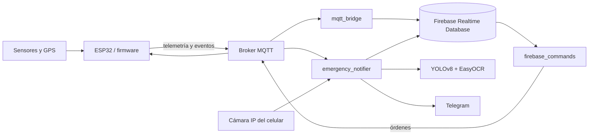

# Arquitectura de Moto-SOS

## Capas

1. **Hardware y firmware ESP32.** `app.py` coordina sensores, actuadores, GPS, emergencia, telemetría y comunicaciones. Los ciclos son temporizados y evitan esperas largas.
2. **Broker MQTT.** Mantiene el contrato entre el casco y los procesos Python. El broker público predeterminado sólo es apropiado para demostraciones controladas.
3. **Servidor Python.** Tres procesos independientes transfieren telemetría a Firebase, traducen comandos Firebase a MQTT y procesan emergencias con Telegram, cámara e IA.
4. **Persistencia y salida.** Firebase Realtime Database conserva estado e histórico. Telegram proporciona el aviso; las fotografías privadas se guardan localmente y, de forma opcional, en Cloud Storage.

## Contrato MQTT

| Tópico | Dirección respecto al ESP32 | Payload | Momento/frecuencia |
|---|---|---|---|
| `motosos/aceleracion` | Publica | Número decimal en G | Cada 2 s y al detectar impacto |
| `motosos/temperatura` | Publica | Número en °C | Cada 2 s si el DHT11 responde |
| `motosos/pulso` | Publica | Entero BPM; `0` sin lectura válida | Cada 2 s |
| `motosos/ubicacion` | Publica | `latitud, longitud` o `Esperando fix GPS...` | Cada 2 s |
| `motosos/gps/estado` | Publica | JSON de fix, estado, satélites, HDOP, edad y contadores | Cada 2 s |
| `motosos/alerta` | Publica | `IMPACTO_DETECTADO` o texto de falsa alarma | En transición de estado |
| `motosos/emergencia/confirmada` | Publica | `EMERGENCIA REAL: ENVIAR FOTOS Y UBICACION` | Tras 5 s sin cancelación |
| `motosos/buzzer/cmd` | Suscribe | `ON` / `OFF` | Bajo demanda |
| `motosos/ventilador/cmd` | Suscribe | `ON` / `OFF` | Bajo demanda |
| `motosos/vibrador/cmd` | Suscribe | `ON` / `OFF` | Bajo demanda |
| `motosos/cancelar/cmd` | Suscribe | `ON` | Durante alerta pendiente |

Los mensajes usan QoS 0 y `retain=False`. El firmware publica telemetría cada `TELEMETRIA_MS = 2000`. Los tópicos no se renombraron durante la reorganización.

## GPS

UART2 se consulta en fragmentos de hasta 256 bytes y un máximo de ocho lecturas por iteración. `GPSNMEA` valida checksum y coordenadas para `$GPGGA`, `$GNGGA`, `$GPRMC` y `$GNRMC`. Los estados son:

- `SIN_NMEA`: no hay tramas NMEA recientes.
- `SIN_FIX`: hay tramas recientes, pero no un fix válido.
- `VALIDO`: el fix y las tramas están dentro de la vigencia configurada.
- `CADUCADO`: existe una posición válida anterior cuya vigencia terminó.

Cuando el estado no es `VALIDO`, `latitud` y `longitud` actuales son nulas. `ultima_latitud`, `ultima_longitud` y `edad_fix_seg` identifican la última posición conocida sin presentarla como actual.

## Decisiones de no regresión

- El firmware conserva pines, umbral de impacto de 1.5 G, cuenta regresiva de 5 s y frecuencia de telemetría de 2 s.
- La IA permanece fuera del ESP32 y las matrículas siguen siendo candidatas no verificadas.
- El primer texto de Telegram se intenta antes de cámara, YOLO y OCR.
- Las rutas privadas se resuelven desde la raíz del repositorio, aunque los módulos se ejecuten con `python -m`.
